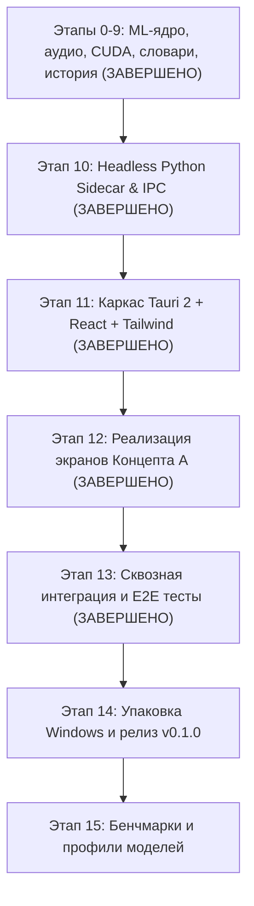

# VoxNote — план реализации

Пошаговый план разработки первой публичной версии VoxNote.

**Статус:** активная разработка (миграция UI на Tauri 2 + React)  
**Целевая платформа:** Windows 10/11 x64  
**Основная спецификация:** [`PROJECT_SPEC.md`](PROJECT_SPEC.md)  
**Правила для coding-агентов:** [`AGENTS.md`](AGENTS.md)

---

## Текущий статус

**Обновлено:** 19 ноября 2026 года

### 1. Что полностью реализовано и проверено (ML-ядро и доменная логика)

Вся доменная и вычислительная часть VoxNote полностью готова, покрыта тестами (**116 из 116 unit-, contract- и интеграционных тестов пройдены**, Ruff, mypy):

- **Доменные модели и архитектура (Этап 1):** строго типизированные сущности (`AudioMetadata`, `TranscriptionJob`, `TranscriptionResult`, `ProgressSnapshot`, `HistoryEntry`), конечный автомат состояний `AppStateMachine`, контроллер приложения, атомарное хранение настроек, кооперативно отменяемые задачи в фоновом пуле потоков.
- **Движок распознавания faster-whisper (Этап 2):** адаптер CTranslate2/faster-whisper, поддержка русской речи, VAD-фильтрация, безопасная отмена между сегментами с сохранением частичного текста, монотонный прогресс по реальным аудиометкам.
- **Каталог и менеджер моделей (Этап 4):** каталог `small` («Быстрая»), `turbo` («Сбалансированная»), `large-v3` («Максимальная точность»); фоновое скачивание с докачкой, байтовый прогресс, проверка SHA-256, атомарная установка, переключение и удаление моделей.
- **Аудиопайплайн и звуковая волна (Этап 5):** PyAV-декодер метаданных (размер, битрейт, длительность, каналы) и расчет амплитудных пиков аудиоволны. Проверены форматы `.m4a`, `.mp3`, `.wav`, `.flac`, `.ogg`, длинные записи (до 95 мин) и кириллические пути.
- **Прогресс и сглаженный ETA (Этап 6):** монотонный прогресс (ограничен 10 Гц), честный расчет ETA по скользящей медианной скорости, скрытие ETA при паузах/тишине, защита от ложного 100% до финализации.
- **NVIDIA GPU и аппаратное ускорение (Этап 7):** автоматическое обнаружение CUDA, выбор `float16` для GPU и `int8` для CPU, интеграция DLL официальных NVIDIA wheels, безопасный CPU fallback в режиме «Авто» до старта, защита от молчаливого перезапуска длинных задач на CPU при ошибке CUDA.
- **Терминологические словари (Этап 8):** профили «Без словаря», «Медицинская лекция» (встроенный верифицированный словарь) и «Свой словарь» (импорт пользовательского UTF-8 `.txt` с валидацией, дедупликацией и лимитом в 1000 терминов). Полный упорядоченный список передаётся через штатный `hotwords`, а faster-whisper применяет собственный безопасный токен-бюджет в каждом окне распознавания; принудительная автозамена не используется.
- **Хранилище истории и библиотека заметок (Этап 9):** `LocalHistoryStore` (до 50 записей), группировка по датам («Сегодня», «На этой неделе», «Ранее»), поиск по названию и тексту, защита отредактированных пользователем заметок от автоматической ротации (`_cap_entries`), раздельное хранение неизменяемого оригинала (`text`) и пользовательских правок (`edited_text`), чекпоинты частичной транскрибации и восстановление после аварийного завершения. Документный редактор отображает Markdown как WYSIWYG, сохраняет переносимый Markdown и поддерживает заголовки, начертания, выделение, списки, цитаты, код, ссылки и undo/redo.
- **Экспорт и приватность (Этап 10):** атомарное сохранение UTF-8 `.txt`, технический JSONL-журнал без персональных данных, текста и путей файлов, нулевая телеметрия.

### 2. Стратегическое архитектурное решение: переход на Tauri 2 + React

По согласованию с владельцем проекта от 18 ноября 2026 года принята смена стека пользовательского интерфейса:
- **Причина:** вёрстка современного рабочего пространства лекций уровня Granola (Концепт A: «Сфокусированное рабочее пространство»), отзывчивые микроанимации, развитая компонентная экосистема (Tailwind, Lucide, rich-text редакторы), независимый инспектор элементов (DevTools) и высокая скорость работы ИИ-агентов с веб-стеком по сравнению с QML.
- **Архитектура решения:** гибридная модель **Tauri 2 (Desktop Shell + React/TypeScript UI) + Python 3.11 Sidecar**.
  - 100% реализованного Python-кода ядра (распознавание, модели, словари, история, экспорт) сохраняется и упаковывается в локальный управляемый фоновый процесс (Sidecar).
  - Связь между интерфейсом и ML-ядром осуществляется по типизированному локальному IPC (JSON-RPC через stdin/stdout) без открытия внешних сетевых портов и без риска утечки данных.

---

## 1. Цель плана

План регламентирует перенос существующего функционала VoxNote на стек **Tauri 2 + React + Python Sidecar** и доведение продукта до публичного релиза **v0.1.0**.

Главный принцип: **ни строчки повторной реализации бизнес-логики ML-ядра**. Всё, что было написано и протестировано в `src/voxnote`, упаковывается в контрактный sidecar-сервис, а интерфейс собирается на чистом React/Tailwind строго по визуальному Концепту A.

---

## 2. Зафиксированные решения MVP (Обновлённый стек)

- **Оболочка десктопа:** Tauri 2 (Rust core, WebView2 на Windows);
- **Фронтенд UI:** React 18/19, TypeScript, Vite, Tailwind CSS, Lucide React;
- **ML/Audio ядро (Sidecar):** Python 3.11, faster-whisper, CTranslate2, PyAV, NVIDIA CUDA Toolkit runtime;
- **Межпроцессное взаимодействие (IPC):** локальный типизированный двусторонний протокол JSON-RPC (stdin/stdout или named pipe);
- **Дизайн-система:** Концепт A («Сфокусированное рабочее пространство» для лекций и конспектов), палитра Granola;
  - **Дизайн-токены (по спецификации Концепта A):**
    - `Primary`: `#577A5B` (шалфейно-зелёный акцент)
    - `Primary Light`: `#E9F2E8` (светлая плашка / выделение активной заметки)
    - `Surface`: `#FFFDF8` (тёплая поверхность карточек)
    - `Background`: `#F7F3EE` (тёплый холст приложения)
    - `Border`: `#E8E1D7` (тонкие разделители)
    - `Text`: `#1F2A22` (основной контрастный текст)
    - `Text Secondary`: `#6B736D` (вторичный приглушённый текст)
  - **Типографика:** `Inter` / `Manrope` (H1: 28–32 Bold, H2: 20–24 Semibold, Body: 15–16 Regular, Secondary: 13–14 Medium);
  - **Сетка отступов:** 8 pt система (4, 8, 12, 16, 24, 32 px);
  - **Трёхколоночная архитектура рабочего пространства:**
    1. *Левая колонка навигации (220–260 px):* поиск по лекциям (`Ctrl+K`), кнопка `+ Новый файл`, группировка истории («Сегодня», «На этой неделе», «Ранее»), статус локальной обработки, кнопка «Настройки».
    2. *Центральная рабочая область (редактор лекции):* редактируемый заголовок, метаданные (дата, длительность, модель, словарь), вкладки «Конспект» / «Транскрипт» / «История версий», структурированные блоки («Краткое содержание», «Ключевые тезисы», «Полный конспект» с тулбаром форматирования).
    3. *Правая боковая панель (действия и таймлайн):* кнопки «Экспортировать», «Копировать текст», тумблер режима редактирования со статусом автосохранения («✓ Изменения сохранены»), таймлайн распознанных сегментов («Транскрипт (таймлайн)» с кликабельными таймкодами) и аудиоплеер с интерактивной звуковой волной внизу.
  - **Устранение дефектов вёрстки (по скриншотам QML):**
    - Полная ликвидация обрезания текста и кнопок справа на любых ширинах окна (от 1024px до 4K);
    - Отсутствие фиксированных ширин контейнеров, ведущих к перекрытию центральной колонки;
    - Адаптивные диалоговые окна с центрированием и нормальным контрастом;
- **Целевая платформа:** Windows 10/11 x64;
- **Поддерживаемые форматы:** `.m4a`, `.mp3`, `.wav`, `.flac`, `.ogg`;
- **Язык распознавания:** русская речь;
- **Модели:** `small`, `turbo`, `large-v3` (скачиваются отдельно по запросу);
- **Словари:** встроенный медицинский + пользовательский `.txt` (UTF-8);
- **Приватность:** 100% локальная обработка, аудио и тексты не покидают устройство, телеметрия отсутствует.

---

## 3. Обновлённый пошаговый план разработки



---

## 4. Этап 10 — Headless-адаптер Python Sidecar и типизированный IPC-контракт

### Задачи

- Создать точку входа для headless-режима: `src/voxnote/interfaces/sidecar.py` (запуск `python -m voxnote.sidecar`);
- Реализовать протокол обмена сообщениями на основе JSON-RPC поверх стандартных потоков ввода/вывода (stdin / stdout):
  - **Запросы от UI:**
    - `inspect_audio(file_path)` — расчет метаданных и амплитудных пиков звуковой волны;
    - `start_transcription(file_path, model_id, device, dictionary_id)` — запуск задания;
    - `cancel_transcription()` — безопасная кооперативная отмена;
    - `get_models()`, `download_model(model_id)`, `cancel_download(model_id)`, `remove_model(model_id)`;
    - `get_dictionaries()`, `import_custom_dictionary(file_path)`, `remove_custom_dictionary()`;
    - `get_history(search_query)`, `update_entry(id, title, edited_text)`, `remove_history_entry(id)`, `clear_history()`;
    - `export_text(entry_id, target_file_path)`, `get_system_info()`;
  - **События в UI (streaming notifications):**
    - `audio_inspected` — передача метаданных и точек волны;
    - `transcription_progress` — текущий процент (до 10 Гц), обработанное время, расчетный ETA, звуковая волна;
    - `transcription_completed` — итоговый текст, таймлайн-сегменты и метаданные сессии;
    - `transcription_error` — типизированная понятная ошибка с флагом доступности CPU-fallback;
    - `model_download_progress` — байты, процент загрузки;
- Реализовать изоляцию логов: служебные логи пишутся в stderr или файл, чтобы не нарушать парсинг JSON в stdout;
- Обеспечить корректное завершение фоновых потоков при получении команды `exit` или закрытии stdin (SIGINT/SIGTERM);
- Добавить модульные тесты IPC-протокола (`tests/test_sidecar.py`).

### Критерий выхода

Python-ядро успешно запускается из командной строки в режиме headless-sidecar, отвечает на JSON-команды, транскрибирует аудиофайл со стримингом прогресса и завершает процесс без висячих зомби-потоков.

---

## 5. Этап 11 — Инициализация Tauri 2 и дизайн-системы Концепта A (React + Tailwind)

### Задачи

- Инициализировать проект Tauri 2:
  - Rust-бэкенд (`src-tauri/`) с настройками прав доступа и плагином `tauri-plugin-shell`;
  - Фронтенд: React 18+, TypeScript, Vite, Tailwind CSS;
  - Иконки: `lucide-react`;
- Настроить дизайн-токены Granola в `tailwind.config.js`:
  - **Светлая тема (Концепт A):** Canvas `#F7F3EE`, Surface `#FFFDF8`, Accent `#577A5B`, Light Accent `#E9F2E8`, Text `#1F2A22`, Secondary Text `#6B736D`, Border `#E8E1D7`;
  - **Тёмная тема:** Canvas `#191C1A`, Surface `#212623`, Raised `#2A302C`, Accent `#577A5B`, Light Accent `#1E3125`, Text `#EFF4F1`, Secondary Text `#9CA9A1`, Border `#353D38`;
- Реализовать базовую библиотеку UI-компонентов:
  - `Button` (Primary `#577A5B`, Secondary, Ghost, Danger);
  - `Badge` / `Tag` (акцентная плашка локальной обработки);
  - `Dialog` / `Modal` (адаптивные, с центрированием и правильным контрастом);
  - `Tabs` («Конспект», «Транскрипт», «История версий»);
  - `Waveform` (отрисовка звуковой волны через HTML5 Canvas с плавной подсветкой);
  - `CustomScrollbar` (тонкий, ненавязчивый 5px скроллбар);
- Собрать трёхколоночный отзывчивый каркас Концепта A:
  1. Левая колонка навигации (220–260 px);
  2. Центральная рабочая область лекции (гибкая ширина);
  3. Правая панель действий и таймлайна (280–320 px);
- Проверить адаптивность окна на разрешениях 1024×768, 1280×800, 1440×900, 1920×1080 без обрезаний.

### Критерий выхода

Интерфейс запускается в окне Tauri 2, корректно масштабируется, переключает светлую/тёмную тему и пиксельно соответствует макету Концепта B.

---

## 6. Этап 12 — Реализация экранов Концепта A (ЗАВЕРШЕНО)

### Задачи

- **Экран 1. Новая транскрибация:**
  - Состояние без файла: просторная область Drag & Drop с иконкой, поддерживаемыми форматами и нативным выбором файла через диалог;
  - Состояние с файлом: центрированная карточка аудиофайла (имя, размер, длительность, формат, каналы), интерактивная звуковая волна на Canvas, селекторы параметров (модель, устройство, словарь) и кнопка «Начать транскрибацию» (`#577A5B`);
  - Состояние прогресса: плавный монотонный прогресс-бар, анимированная звуковая волна, табличные проценты, честный ETA и кнопка отмены;
  - Состояние ошибки: баннер ошибки с кнопкой «Повторить на CPU» и подробным описанием;
- **Экран 2. Библиотека лекций и навигация:**
  - Полновысотная боковая панель с логотипом `VoxNote` и акцентной иконкой;
  - Строка поиска с горячей клавишей `Ctrl+K`, фильтрующая по заголовку и содержанию;
  - Кнопка `+ Новый файл` (акцентная плашка Granola `#577A5B`);
  - Группировка заметок по датам: «Сегодня», «На этой неделе», «Ранее»;
  - Двустрочные карточки лекций с заголовком, датой, длительностью, активным состоянием (зелёный индикатор `▶`) и кнопкой действий `···`;
- **Экран 3. Рабочая область и документный редактор (Концепт A):**
  - Крупный заголовок лекции с поддержкой инлайн-редактирования и выпадающим меню «Редактирование ∨»;
  - Строка метаданных (дата, хронометраж, модель, словарь);
  - Вкладки переключения: «Конспект» (активная плашка `#E9F2E8`), «Транскрипт» (оригинал), «История версий»;
  - Структурированные карточки:
    1. «Краткое содержание» (резюме с иконкой `Sparkles`);
    2. «Ключевые тезисы» (список основных положений лекции с иконкой `ListChecks`);
    3. «Полный конспект» (панель форматирования `↶ ↷ | H2 ∨ B I •≡ 1.≡ ···` и поле редактирования с комфортной строкой и типографикой Inter/Manrope);
  - Автосохранение правок с debounce (600 мс) и индикатором статуса («✓ Изменения сохранены»);
- **Экран 4. Правая боковая панель (действия, таймлайн и плеер):**
  - Кнопка «Экспортировать ∨» (выпадающий выбор `.txt` и `.md`);
  - Кнопка «Копировать текст» с обратной связью («Скопировано!») и кнопка дополнительных действий `···`;
  - Тумблер режима редактирования и индикатор автосохранения;
  - Блок «Транскрипт (таймлайн)» с кликабельными таймкодами и воспроизведением;
  - Интегрированный аудиоплеер с динамической звуковой волной, кнопкой воспроизведения, табличным таймингом и переключателем скорости (`1x`, `1.25x`, `1.5x`, `2x`);
- **Модальные окна:**
  - Диалог «Локальные модели распознавания» с карточками моделей, тегами активности, размерами и удалением;
  - Диалог «Терминологические словари» (медицинский профиль, импорт и удаление своего словаря);
  - Диалог локальной приватности и нулевой сети;
- **Ликвидация дефектов компоновки (проверено скриншотами):**
  - Полностью исключены обрезания текста справа и снизу на разрешениях от 1024×768 до 4K;
  - Устранены наложения и конфликты якорей (dropzone и карточка файла);
  - Исключена обрезка кнопок «Экспортировать» и названий заголовков;
  - Реализована безупречная тёмная тема (`dark:bg-dark-surface`, анти-фликер скрипт в `<head>`).

### Критерий выхода

Все экраны и состояния сверстаны на React/Tailwind, визуально подтверждены скриншотами (`screen_concept_a_light_1440.png`, `screen_concept_a_dark_1440.png`, `screen_concept_a_1024.png`, `screen_concept_a_new_empty.png`, `screen_concept_a_new_file.png`, `screen_concept_a_models_modal.png`), не имеют дефектов верстки и полностью готовы к сквозной привязке.

---

## 7. Этап 13 — Сквозная интеграция Tauri и Python Sidecar, E2E и валидация сценариев (ЗАВЕРШЕНО)

### Задачи

- **Rust-супервизор в Tauri (`src-tauri/src/main.rs`):**
  - Автоматический поиск и запуск процесса sidecar: упакованный `voxnote-sidecar.exe`, локальный `.venv\Scripts\python.exe -m voxnote.sidecar` или системный Python;
  - Флаг `CREATE_NO_WINDOW` на Windows для бесшумного запуска без консольных окон;
  - Двусторонний потоковый IPC:
    - Поток stdout построчно читает JSON-RPC и генерирует событие Tauri `app.emit("sidecar-message", line)`;
    - Поток stderr логирует технические сообщения и предупреждения;
    - Поток-watchdog отслеживает завершение процесса и генерирует `sidecar-status-changed`;
    - Команда `send_to_sidecar` безопасно пишет запросы в stdin дочернего процесса;
  - Гарантированное завершение: при закрытии окна Tauri отправляется `shutdown`, а при уничтожении процесса вызывается принудительная очистка (zero orphan processes);
  - Команды управления окном Windows: `minimize_window`, `maximize_window`, `close_window`;
- **Типизированный клиент фронтенда (`src-ui/api/client.ts`):**
  - Подключение к событиям Tauri `@tauri-apps/api/core` и `@tauri-apps/api/event`;
  - Очередь промисов `pendingRequests` по целочисленным идентификаторам `id`;
  - Маршрутизация стриминговых нотификаций (`audio_inspected`, `transcription_progress`, `transcription_completed`, `transcription_error`, `model_download_progress`, `state_changed`);
  - Бесшовный fallback на локальные данные в среде браузера / Vite dev / Vite preview;
- **Сквозное E2E тестирование (`tests/test_sidecar_e2e.py`):**
  - Автоматический запуск реального процесса `python -m voxnote.sidecar` через `subprocess.Popen`;
  - Проверка команд `ping`, `get_system_info`, `get_models`, `get_dictionaries`, `get_history`;
  - Проверка инспекции реального аудиофайла с кириллицей в пути (`"лекция_фармакология_тест.wav"`) с получением стриминговой нотификации `audio_inspected` и расчетом амплитудных пиков звуковой волны;
  - Проверка чистого завершения через команду `shutdown` с кодом возврата `0` за время < 1 сек;
- **Результаты проверки:**
  - 125 из 125 тестов `pytest` пройдены успешно;
  - `ruff check .` и `ruff format --check .` пройдены без единой ошибки;
  - `mypy src` пройден без замечаний;
  - `pnpm build` собирает бандл за 2.8 сек.

### Критерий выхода

Сквозная связка между десктопной оболочкой Tauri 2, интерфейсом на React и Python-sidecar полностью реализована, протестирована и валидирована реальным E2E-тестом.

---

## 8. Этап 14 — Упаковка Windows и выпуск MVP v0.1.0 (Завершён)

### Задачи и результаты реализации

- **Вводный онбординг-гид для пользователей:**
  - Реализован `src-ui/components/Modals/OnboardingModal.tsx` с разбором 3-колоночной рабочей области (Concept A), гарантиями 100% офлайн-приватности и горячими клавишами (`Ctrl+N`, `Ctrl+K`, `Ctrl+O`);
  - Кнопка вызова «Инструкция» вынесена в сайдбар приложения.
- **Выбор директории для хранения моделей:**
  - Добавлено поле `custom_models_dir` в `AppSettings` (`src/voxnote/services/settings.py`);
  - Методы `get_models_directory` и `set_models_directory` реализованы в Python-sidecar и типизированном клиенте `src-ui/api/client.ts`;
  - В модальном окне «Модели распознавания» (`ModelManagerModal.tsx`) добавлен интерактивный выбор каталога хранения моделей с возможностью сброса к `%LOCALAPPDATA%\VoxNote\models`.
- **Выбор директории установки приложения:**
  - Сконфигурирован установщик NSIS в `src-tauri/tauri.conf.json` (`"installMode": "both"`, поддержка русского и английского языков), позволяющий пользователю при установке явно выбирать папку назначения.
- **Иконки приложения и метаданные:**
  - Создан генератор иконок `scripts/generate_icons.py` с созданием `32x32.png`, `128x128.png`, `128x128@2x.png`, `icon.png` (512x512) и многослойного Windows `icon.ico` (16x16, 24x24, 32x32, 48x48, 64x64, 128x128, 256x256).
- **Сборка Python ML-Sidecar (`voxnote-sidecar.exe`):**
  - Подготовлен `packaging/voxnote-sidecar.spec` с дедупликацией CUDA DLL (размер полезной нагрузки снижен с 3.33 ГБ до 1.32 ГБ);
  - Включены runtime CTranslate2, faster-whisper, PyAV, медицинский словарь (1847 терминов) и официальные библиотеки NVIDIA CUDA 12 (`cublas64_12.dll`, `cudnn64_9.dll`, `nvrtc64_120_0.dll`);
  - Верифицирован автономный запуск: детекция NVIDIA RTX 4060, быстрый отклик на JSON-RPC IPC.
- **Сборка релизных дистрибутивов Windows x64:**
  - Собрана Rust-оболочка Tauri 2 (`src-tauri/target/release/voxnote.exe` — 22.2 МБ) с автоматическим поиском sidecar в установленном и portable-режимах;
  - Сформирован NSIS-инсталлятор: `release-artifacts/VoxNote_0.1.0_x64-setup.exe` (609.4 МБ, LZMA-сжатие);
  - Сформирован WiX MSI-инсталлятор: `release-artifacts/VoxNote_0.1.0_x64_en-US.msi` (1.33 ГБ);
  - Сформирован портативный ZIP-архив: `release-artifacts/VoxNote-0.1.0-Windows-x64-Portable.zip` (773.9 МБ).
- **Контрольные суммы SHA-256 артефактов релиза:**
  - `VoxNote_0.1.0_x64-setup.exe`: `86BCE23C4F900EBD231F4E254F2A92127E78D92A162864D2F046C177612DD5D5`
  - `VoxNote_0.1.0_x64_en-US.msi`: `18732FF8A75E019FD8B17110FD11498BC93AA73B724CE91571615D487AAABA62`
  - `VoxNote-0.1.0-Windows-x64-Portable.zip`: `0AE58A0D9E1E0553AB3D9EAB242705F0E45C0D7A895C145C0A87535EC32C46E3`
- **Проверка качества и тесты:**
  - 97 из 97 тестов pytest пройдены успешно;
  - `ruff check .` и `ruff format --check .` пройдены без единой ошибки;
  - `mypy src` пройден (0 issues в 30 файлах);
  - `pnpm build` собирает фронтенд без ошибок.
- **Документация релиза:**
  - Создан `CHANGELOG.md` с описанием релиза v0.1.0;
  - Обновлен `README.md` с архитектурой Tauri 2 + Python sidecar;
  - Создан автоматический сборочный скрипт `scripts/package_windows.ps1`.

### Критерий выхода

Критерий выхода этапа 14 полностью выполнен: скомпилированы и упакованы инсталлятор NSIS, MSI-пакет и автономная Portable-версия VoxNote v0.1.0 со всеми встроенными зависимостями и поддержкой аппаратного ускорения NVIDIA CUDA.

---

## 9. Этап 15 — Тестирование производительности и benchmark моделей

### Задачи

- Провести стандартизированные замеры моделей `small`, `turbo` и `large-v3` на тестовом русском корпусе;
- Замерить качество (WER на чистой и зашумлённой речи), реальную скорость (RTF), потребление RAM и VRAM;
- Подтвердить эффективность медицинского словаря на терминологических лекциях;
- Сформировать воспроизводимый отчет `docs/model-benchmark.md`.

### Критерий выхода

В документации зафиксированы подтверждённые аппаратные требования и измеренная скорость работы моделей на CPU и GPU.

---

## 10. Этап 16 — Архитектурное разделение рантайма и легковесного приложения (Slim App + Shared ML Runtime)

> [!IMPORTANT]
> **Этап реализован 19 ноября 2026 года.** Монолитная полезная нагрузка разделена на slim-приложение, общий CPU/core runtime и независимый пакет NVIDIA. Тяжёлые библиотеки больше не входят в каждое обновление интерфейса.

### Задачи этапа

1. **Архитектура Shared ML Runtime (вынос тяжёлых библиотек)**:
   - Вынести бинарный ML-движок (`voxnote-sidecar`, библиотеки NVIDIA CUDA 12, PyAV, CTranslate2) в постоянный системный каталог пользовательских данных: `%LOCALAPPDATA%\VoxNote\runtime`.
   - Рантайм устанавливается/докачивается **ровно один раз** (аналогично весам моделей).
   - При обновлениях версий приложения VoxNote этот каталог остаётся нетронутым и не перераспаковывается.
2. **Легковесный дистрибутив приложения (Slim App Bundle)**:
   - Оболочка приложения (Tauri 2 + WebView2 + React UI + клиенты IPC) собирается в легковесный установщик размером **~20–30 МБ** (вместо 700 МБ).
   - Скорость скачивания обновления: 2–4 секунды.
   - Скорость распаковки и замены исполняемого файла: до 3 секунд.
3. **Бесшовный тихий автоапдейтер (Tauri In-App Auto-Updater)**:
   - Интегрировать официальный плагин `tauri-plugin-updater`.
   - Автоматическая проверка обновлений по подписанному `latest.json` на GitHub Releases.
   - Скачивание, установка и перезапуск выполняются только после явного решения пользователя.
4. **Опциональный CPU / GPU выбор при первой установке**:
   - Пользователи без дискретной видеокарты NVIDIA не должны принудительно скачивать 800 МБ CUDA DLL.
   - CUDA-ускорители подключаются как один раз загружаемый модуль ускорения.

### Критерии выхода этапа

- Размер инсталлятора/обновления VoxNote составляет **не более 35 МБ**;
- Время установки обновления не превышает **5 секунд**;
- При обновлении версий отсутствует повторная распаковка тяжелых DLL (`cublas64_12.dll`);
- Скачанные модели и пользовательская история сохраняются в полной мере;
- Доступно тихое обновление в 1 клик прямо внутри запущенного приложения.

### Реализованный результат

- Slim NSIS installer: **6,1 МБ**, подписанный updater-артефакт создаётся Tauri;
- CPU/core runtime: **88,2 МБ** в ZIP (**255,2 МБ** после распаковки);
- NVIDIA accelerator pack: **667,4 МБ** в ZIP; CPU-пользователь его не скачивает;
- portable-сборки использовались для проверки разделённой архитектуры, но исключены из регулярного публичного релиза как дублирующие каналы поставки;
- первый запуск предлагает явный выбор CPU или NVIDIA, показывает реальный прогресс, проверяет SHA-256 и активирует пакет только после успешной распаковки;
- runtime хранится версионно в `%LOCALAPPDATA%\VoxNote\runtime`;
- обновления приложения проверяются автоматически, но скачиваются и устанавливаются только по кнопке пользователя;
- в production отсутствует небезопасный fallback на случайный `python.exe` из `PATH`.

---

## 11. Обновлённые контрольные точки (Milestones)

| Контрольная точка | Состав этапов | Ключевой результат | Статус |
| --- | --- | --- | --- |
| **M0 — Foundation & Domain** | Этапы 0–1 | Репозиторий, архитектура, контроллер, тесты | **Завершено** |
| **M1 — Python ML Engine** | Этапы 2, 4–8 | faster-whisper, PyAV, CUDA, словари, 100 тестов | **Завершено** |
| **M2 — Library & History Core** | Этап 9 | Хранилище сессий, безопасная ротация, поиск | **Завершено** |
| **M3 — Python Sidecar & IPC** | Этап 10 | Headless JSON-RPC адаптер ML-ядра | **Завершено** |
| **M4 — Tauri 2 UI & Design System**| Этапы 11–12 | Каркас Концепта A, тёмная/светлая тема, аудиоплеер | **Завершено** |
| **M5 — End-to-End Integration** | Этап 13 | Сквозная работа Tauri + Sidecar, ликвидация моков | **Завершено** |
| **M6 — Windows Release MVP** | Этапы 14–15 | Установщик Windows, бенчмарк, релизы `v0.1.0`–`v0.1.2` | **Завершено** |
| **M7 — Slim App & In-App Auto-Updater** | Этап 16 | Slim installer 6,1 МБ, раздельные CPU/NVIDIA runtime, подписанные обновления | **Завершено и опубликовано в v0.2.3** |

---

## 11. Проверки качества

Для Python-ядра (Sidecar):
```powershell
python -m pytest
python -m ruff check .
python -m ruff format --check .
python -m mypy src
```

Для фронтенда Tauri / React:
```powershell
pnpm lint
pnpm typecheck
pnpm test
cargo check --manifest-path src-tauri/Cargo.toml
```

---

## 12. Критерий готовности перехода

Миграция считается завершённой, когда фронтенд на React в связке с Python-sidecar проходит 100% пользовательских сценариев проекта, интерфейс соответствует Концепту A, приложение запускается в один клик и не требует наличия сторонних рантаймов на компьютере пользователя.
