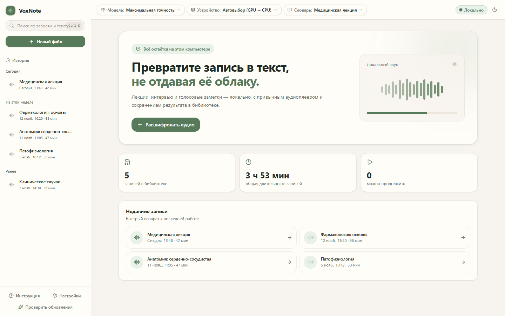
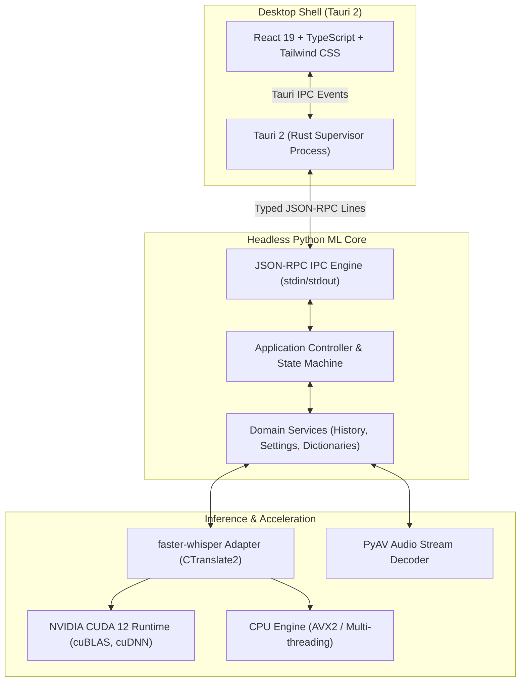

<div align="center">

# VoxNote

**Локальная офлайн-транскрибация русскоязычных аудиозаписей для Windows**

*Сфокусированное рабочее пространство для конспектирования лекций, вебинаров, докладов и медицинской терминологии.*

[](https://github.com/wrldwideme/VoxNote/releases/tag/v0.2.2)
[](LICENSE)
[](https://github.com/wrldwideme/VoxNote)
[](docs/privacy.md)
[](docs/gpu-setup.md)
[-FFC131?style=flat-square&logo=tauri)](https://v2.tauri.app)
[](https://python.org)

<br/>

[**Скачать VoxNote v0.2.2**](https://github.com/wrldwideme/VoxNote/releases/latest) •
[**Документация**](#-документация) •
[**Спецификация (PROJECT_SPEC)**](PROJECT_SPEC.md) •
[**Архитектура**](#-архитектура)

<br/>



</div>

<br/>

---

## ⚡ О проекте

**VoxNote** создавался как надежный персональный инструмент для студентов, исследователей, врачей и специалистов, которым нужно быстро превращать длинные аудиозаписи и лекции в качественный текст **без передачи звука и данных на чужие сервера**.

### Ключевые преимущества

- 🔒 **100% офлайн и приватность:** ни одного байта вашего звука или расшифровки не отправляется в облако. Во время распознавания сетевой доступ полностью заблокирован.
- 🚀 **Высокая скорость (GPU + CPU):** поддержка аппаратного ускорения **NVIDIA CUDA 12** (Tensor Core, cuBLAS, cuDNN). При отсутствии видеокарты задействуется оптимизированный CPU-рантайм (AVX2).
- 🩺 **Терминологические словари:** встроенная поддержка медицинского словаря (1 847 терминов) и импорт пользовательских `.txt` файлов с терминами для точного распознавания сложной лексики.
- 🎨 **Современный UX (Концепт A / Стилистика Granola):** продуманная 3-колоночная компоновка, светлая, тёмная и системная темы, визуализация звуковой волны, адаптация под `prefers-reduced-motion`.
- ⏱ **Честный прогресс:** процент выполнения считается по декодированному таймлайну аудио, а расчет ETA адаптируется к реальной скорости вашей системы.
- 💾 **Удобный экспорт:** форматированный текст без таймкодов, экспорт в `.txt` и `.md`, мгновенное копирование в буфер обмена.
- 📁 **Полный контроль над файлами:** выбор папки установки приложения и каталога для хранения загружаемых моделей.

---

## 🖼 Интерфейс

| Светлая тема (Granola) | Тёмная тема |
|:---:|:---:|
|  |  |

---

## 📥 Загрузка (v0.2.2)

| Дистрибутив | Формат | Размер | Назначение |
|---|:---:|:---:|---|
| [**VoxNote_0.2.2_x64-slim-setup.exe**](https://github.com/wrldwideme/VoxNote/releases/download/v0.2.2/VoxNote_0.2.2_x64-slim-setup.exe) | NSIS Installer | **6,1 МБ** | **Рекомендуемый лёгкий установщик**; runtime выбирается при первом запуске |
| [**VoxNote-0.2.2-Windows-x64-CPU-Portable.zip**](https://github.com/wrldwideme/VoxNote/releases/download/v0.2.2/VoxNote-0.2.2-Windows-x64-CPU-Portable.zip) | Portable ZIP | **97,2 МБ** | Автономная CPU-версия без установки и CUDA |
| [**VoxNote-0.2.2-Windows-x64-Full-NVIDIA-Portable.zip**](https://github.com/wrldwideme/VoxNote/releases/download/v0.2.2/VoxNote-0.2.2-Windows-x64-Full-NVIDIA-Portable.zip) | Portable ZIP | **764,5 МБ** | Полная автономная версия с NVIDIA CUDA runtime |

При первом запуске slim-версии пользователь сам выбирает CPU или NVIDIA. Ничего не скачивается до этого выбора. Runtime устанавливается один раз в `%LOCALAPPDATA%\VoxNote\runtime`; последующие небольшие обновления интерфейса его не затрагивают. Проверка новой версии автоматическая, но скачивание и установка начинаются только после подтверждения пользователя.

### 🔐 Контрольные суммы файлов

```text
1abf3f1b92734bd12d5b1f9df70845cf8f1198ea216303a4f3d4807088eac507  VoxNote_0.2.2_x64-slim-setup.exe
008bc60e0a7371c7f05ac7e3cadfce308719c7ae019eae97e16499dd08548ece  VoxNote-0.2.2-Windows-x64-CPU-Portable.zip
8b4689718101fcc98b0e773770d0a8aaef32427709a3865bd76671487514a798  VoxNote-0.2.2-Windows-x64-Full-NVIDIA-Portable.zip
```

---

## 🏗 Архитектура

Приложение спроектировано по гибридной десктопной модели с изоляцией UI от тяжелых вычислений:



---

## 💻 Системные требования

- **Операционная система:** Windows 10 x64 / Windows 11 x64;
- **Процессор:** x86_64 с поддержкой AVX2 (Intel Core 4th Gen+ / AMD Ryzen);
- **Оперативная память:** от 8 ГБ RAM (16 ГБ для модели `large-v3`);
- **Видеокарта (опционально):** NVIDIA GPU с поддержкой CUDA Compute Capability >= 7.0 (GTX 1650+, RTX 2060+, RTX 30xx, RTX 40xx);
- **Поддерживаемые аудиоформаты:** `.m4a`, `.mp3`, `.wav`, `.flac`, `.ogg`.

---

## 🛠 Сборка из исходников (для разработчиков)

### 1. Подготовка окружения

1. **Python 3.11 x64** и виртуальное окружение:
   ```powershell
   python -m venv .venv
   .\.venv\Scripts\Activate.ps1
   python -m pip install --upgrade pip
   python -m pip install -e ".[dev,gpu]"
   ```

2. **Node.js 18+** и **pnpm**:
   ```powershell
   pnpm install
   ```

3. **Rust Toolchain:**
   ```powershell
   rustup default stable-x86_64-pc-windows-gnu  # или stable-x86_64-pc-windows-msvc
   ```

### 2. Запуск в режиме разработки

```powershell
# Запуск полнофункционального десктопного приложения в dev-режиме:
pnpm tauri dev
```

В dev-режиме супервизор Tauri автоматически запустит Python Sidecar из локального `.venv` с горячей перезагрузкой React-интерфейса через Vite.

### 3. Полный цикл автоматической упаковки

```powershell
powershell -ExecutionPolicy Bypass -File scripts/package_windows.ps1
```

Скрипт автоматически:
1. Генерирует наборы мультииконок (`generate_icons.py`);
2. Собирает CPU/core runtime через PyInstaller без CUDA-библиотек;
3. Формирует отдельные архивы core runtime и NVIDIA accelerator pack и записывает их SHA-256 в manifest;
4. Собирает фронтенд (`pnpm build`) и подписанный slim NSIS installer Tauri;
5. Создаёт подписанные updater-метаданные `latest.json`;
6. Формирует отдельные CPU Portable и Full NVIDIA Portable.

Для подписания updater нужен приватный ключ Tauri в `%LOCALAPPDATA%\VoxNote\release-keys\updater.key`. Ключ не хранится в репозитории и не должен попадать в release-артефакты.

### 4. Тесты и линтеры

```powershell
# Python unit-, integration- и IPC contract-тесты:
.\.venv\Scripts\python.exe -m pytest

# Проверка стиля и типизации:
.\.venv\Scripts\python.exe -m ruff check .
.\.venv\Scripts\python.exe -m ruff format --check .
.\.venv\Scripts\python.exe -m mypy src

# Сборка фронтенда:
pnpm test
pnpm build
```

Общий IPC-контракт React и Python хранится в
[`resources/ipc_contract.json`](resources/ipc_contract.json). Изменение RPC-метода или события
требует одновременного обновления контракта и соответствующих тестов.

---

## 📚 Документация

- [**PROJECT_SPEC.md**](PROJECT_SPEC.md) — Продуктовая спецификация и требования;
- [**IMPLEMENTATION_PLAN.md**](IMPLEMENTATION_PLAN.md) — Пошаговый план реализации с отчетами по этапам;
- [**CHANGELOG.md**](CHANGELOG.md) — История изменений по версиям;
- [**RELEASE_NOTES_v0.2.2.md**](RELEASE_NOTES_v0.2.2.md) — Примечания к текущему релизу;
- [**docs/privacy.md**](docs/privacy.md) — Локальная приватность и нулевой сетевой доступ;
- [**docs/dictionaries.md**](docs/dictionaries.md) — Руководство по встроенным и пользовательским словарям;
- [**docs/gpu-setup.md**](docs/gpu-setup.md) — Настройка и диагностика видеокарт NVIDIA CUDA.

---

## ⚖️ Лицензия

Код проекта распространяется под лицензией **MIT License** — подробнее в файле [LICENSE](LICENSE).  
Используемые сторонние библиотеки (`faster-whisper`, `CTranslate2`, `PyAV`, `Tauri`, `React`) и веса моделей Whisper сохраняют свои оригинальные лицензии.
