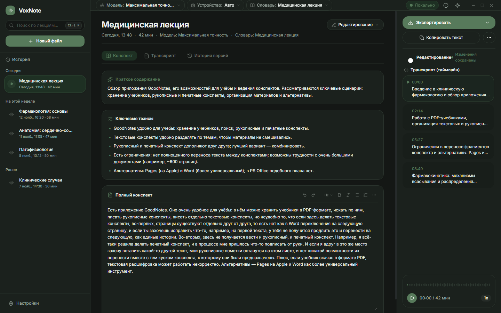
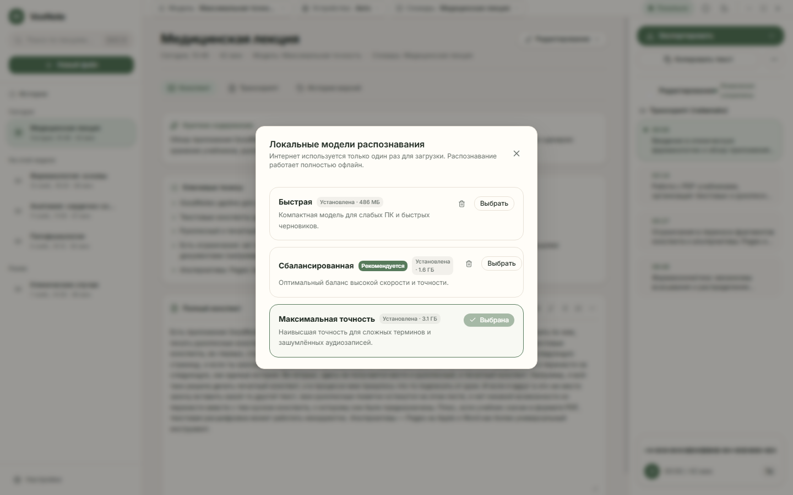

<div align="center">


# VoxNote

### Ваши записи — в текст. Спокойно, красиво и полностью локально.

VoxNote превращает русскоязычные лекции, встречи и голосовые заметки в аккуратный текст на вашем Windows-компьютере. Аудио, словари и расшифровки не отправляются в облако.

[](https://github.com/wrldwideme/VoxNote/releases/tag/v0.2.4)
[](https://github.com/wrldwideme/VoxNote/releases/latest)
[](docs/privacy.md)
[](LICENSE)

### [Скачать VoxNote для Windows](https://github.com/wrldwideme/VoxNote/releases/download/v0.2.4/VoxNote_0.2.4_x64-slim-setup.exe)

Один лёгкий установщик · 6,1 МБ · Windows 10/11 x64

</div>


## Только то, что нужно вашему компьютеру

Мы разделили VoxNote на три независимые части. Поэтому обновление интерфейса больше не заставляет заново скачивать CUDA, а модели не занимают место, пока вы сами их не выберете.

| 01 — Приложение | 02 — Движок | 03 — Модель |
|---|---|---|
| Скачайте один установщик размером **6,1 МБ**. | Выберите универсальный **CPU (~88 МБ)** или **CPU + NVIDIA (~756 МБ)** для ускорения. | Выберите качество распознавания: **~0,5 / 1,6 / 3,1 ГБ**. |
| Быстрые обновления UI. | Устанавливается один раз и живёт отдельно. | Можно менять и удалять в любое время. |

Ничего не скачивается скрытно. VoxNote показывает реальный размер, прогресс и проверяет SHA-256 до активации пакета.

## Почему VoxNote

- **Всё остаётся у вас.** Распознавание выполняется локально; аудио и готовый текст не уходят на сервер.
- **Создан для русского языка.** Поддерживаются `.m4a`, `.mp3`, `.wav`, `.flac` и `.ogg`.
- **Подстраивается под компьютер.** Работает на CPU и умеет использовать совместимую NVIDIA GPU.
- **Понимает сложные термины.** Есть медицинский словарь и импорт собственного списка терминов.
- **Показывает честный прогресс.** Процент основан на обработанной позиции аудио, ETA — на реальной скорости.
- **Не мешает сосредоточиться.** Светлая, тёмная и системная темы, аккуратная типографика и reduced motion.

## Интерфейс, в котором приятно остаться

| Светлая тема | Тёмная тема |
|:---:|:---:|
|  |  |

<div align="center">



*Три понятных режима вместо списка технических checkpoint-файлов.*

</div>

## Установка

1. Скачайте [VoxNote_0.2.4_x64-slim-setup.exe](https://github.com/wrldwideme/VoxNote/releases/download/v0.2.4/VoxNote_0.2.4_x64-slim-setup.exe).
2. При первом запуске выберите базовый CPU-движок или вариант с ускорением NVIDIA.
3. Выберите модель распознавания — быструю, сбалансированную или максимально точную.
4. Перетащите аудиофайл и начните транскрибацию.

Runtime и модели загружаются только после вашего действия. Во время самой транскрибации сетевые запросы запрещены.

### SHA-256 установщика

```text
30fa62e8565ad20caea1e203c2906b296896decb4b11b8569d5f882208fbe7a3  VoxNote_0.2.4_x64-slim-setup.exe
```

## Системные требования

- Windows 10 или Windows 11 x64;
- минимум 8 ГБ RAM, рекомендуется 16 ГБ;
- процессор с AVX2;
- опционально — совместимая NVIDIA GPU для ускорения;
- свободное место под выбранный runtime и модель.

## Как устроена приватность

```text
Аудиофайл → локальный Python-sidecar → faster-whisper → текст на вашем диске
```

Сеть изолирована в менеджерах runtime, моделей и обновлений. Она используется только после явного действия пользователя. Телеметрии, аналитики и crash-reporting SDK в приложении нет. Подробнее — в [политике приватности](docs/privacy.md).

<details>
<summary><strong>Для разработчиков</strong></summary>

### Стек

- Tauri 2 и Rust — desktop shell и управление локальным runtime;
- React, TypeScript и Tailwind CSS — интерфейс;
- Python 3.11, faster-whisper, CTranslate2 и PyAV — ML-ядро;
- типизированный JSON-RPC — связь UI и sidecar.

### Подготовка окружения

```powershell
python -m venv .venv
.\.venv\Scripts\Activate.ps1
python -m pip install -e ".[dev]"
pnpm install --frozen-lockfile
```

### Запуск

```powershell
pnpm tauri dev
```

### Проверки

```powershell
python -m pytest
python -m ruff check .
python -m ruff format --check .
python -m mypy src tests
pnpm test
pnpm build
cargo check --locked --manifest-path src-tauri/Cargo.toml
```

### Сборка

Обычный релиз приложения собирает только slim installer и updater-метаданные:

```powershell
.\scripts\package_windows.ps1
```

ML-runtime имеет независимую версию и пересобирается только при изменениях Python-ядра или CUDA-зависимостей:

```powershell
.\scripts\package_runtime.ps1 -RuntimeVersion X.Y.Z
```

Полный процесс описан в [docs/releasing.md](docs/releasing.md).

</details>

## Документация

- [Продуктовая спецификация](PROJECT_SPEC.md)
- [План реализации](IMPLEMENTATION_PLAN.md)
- [История изменений](CHANGELOG.md)
- [Примечания к v0.2.4](docs/releases/v0.2.4.md)
- [Приватность](docs/privacy.md)
- [Модели и NVIDIA GPU](docs/gpu-setup.md)
- [Словари](docs/dictionaries.md)
- [Релизный процесс](docs/releasing.md)

## Лицензия

VoxNote распространяется по лицензии [MIT](LICENSE). Веса моделей Whisper и сторонние библиотеки сохраняют собственные лицензии.
